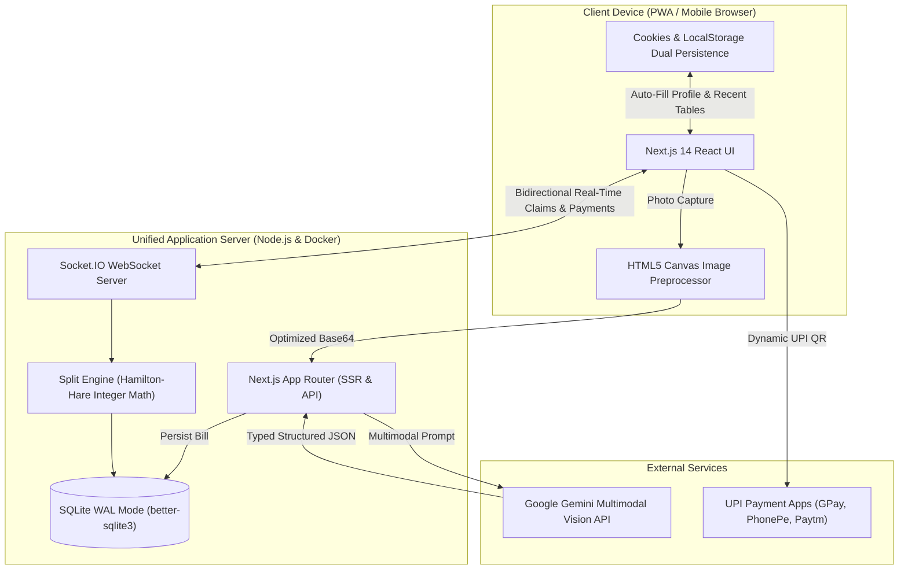

# SplitPay 🧾💸

> **Smart group dining, fair itemized splits, one seamless payment.**

[](https://splitpay-4aut.onrender.com)
[](https://nextjs.org/)
[](https://www.typescriptlang.org/)
[](https://socket.io/)
[](https://ai.google.dev/)
[](https://web.dev/progressive-web-apps/)
[](https://vitest.dev/)
[](LICENSE)

SplitPay is a real-time group dining and bill-settlement web application designed to eliminate the awkwardness and mathematical chaos of dining in large groups. Instead of forcing waitstaff to split cards or forcing one person to front a massive bill and chase friends for payment, SplitPay digitizes the receipt, calculates individual shares down to the paise, collects payments into a centralized pool via dynamic UPI QR codes, and ensures the venue receives a single accurate settlement.

**🌐 Live Application:** [https://splitpay-4aut.onrender.com](https://splitpay-4aut.onrender.com)  
**📂 GitHub Repository:** [https://github.com/Ish4n-pixel/splitpay](https://github.com/Ish4n-pixel/splitpay)

---

## 🌟 Key Features

- **Multimodal AI Vision Receipt Scanning:** Snap a receipt photo with your smartphone camera. SplitPay uses **Google Gemini Multimodal Vision** with typed JSON schema enforcement to extract dish names, quantities, unit prices, line item totals, GST/taxes, and grand total. Automatically filters out noisy metadata (restaurant addresses, FSSAI/GSTIN codes, cashier/waiter IDs, timestamps).
- **Client-Side Image Downscaling Preprocessor:** Built-in HTML5 Canvas preprocessor downscales heavy 12–48MP mobile camera photos (5–15MB) to optimal 1600px dimensions with contrast boosting in <100ms (~250KB–350KB), eliminating network timeouts and payload-size crashes.
- **Portion-Based Dish Claiming:** Claim exact portions of grouped dishes (e.g. claim 1 out of 3 Chicken Tikkas) rather than being forced to take all 3. Pay strictly for what you ate.
- **Claim Locking Protection:** Dishes or portions already claimed by earlier diners are automatically locked to prevent latecomers from over-claiming or claiming someone else's food.
- **Fair Proportional Fee Allocation:** Taxes, GST, tips, and service charges are distributed proportionally to each person's food spend so lighter eaters never subsidize heavy eaters. Flat equal division is also available with a single toggle.
- **Flexible Tax & Tip Modes:** Add GST, service charges, or tips as either percentage (`%`) or fixed rupee amount (`₹ Fixed`).
- **Host Self-Dish Verification:** Hosts can claim their own dishes directly from the Host Dashboard with 1-click quick-claim buttons. Host-claimed items automatically advance the settled progress bar.
- **Zero-Penny Invariant Precision:** 100% of arithmetic is computed in integer paise using the **Largest-Remainder (Hamilton-Hare)** method, guaranteeing mathematical zero-discrepancy down to the penny.
- **Zero App Installation Friction & Mobile PWA Widget:** Guests scan a table QR code or open a short link in their mobile browser—no downloads or logins required. Can also be added directly to mobile home screens as a native PWA widget with quick action shortcuts (Host Table / Join Table).
- **1-Year Cookie Persistence & Quick-Resume Tray:** Remembers host and diner profiles (name, UPI ID, fee preferences) with 1-year cookies and localStorage dual-sync. Regular users are auto-filled and can resume active tables with a single tap.
- **Real-Time Live Sync:** Powered by Socket.IO, the entire table updates simultaneously as diners claim items, log cash, or make payments.
- **Dynamic UPI Settlement:** Generates individual UPI QR codes mapped to the host's UPI ID (`upi://pay?pa=...`), pre-filled with each diner's exact amount due.
- **Mixed Payment Support:** Real-time cash logging ("Paid Cash") and 1-tap proxy covers ("A covers B").

---

## 🏗️ Architecture & Data Flow



---

## 🛠️ Tech Stack

| Layer | Technology | Rationale |
|---|---|---|
| **Framework** | Next.js 14 (App Router) | Server-side rendering, API route handling, and optimized React hydration |
| **Language** | TypeScript 5.6 | Strict end-to-end type safety across client, server, and split engine |
| **Real-Time Sync** | Socket.IO 4.8 | Low-latency bi-directional event synchronization across multiple diner devices |
| **Database** | SQLite (`better-sqlite3`) | High-performance, zero-latency in-process database with WAL journal mode |
| **AI Vision & OCR** | Google Gemini Multimodal Vision API | Structured receipt JSON extraction with candidate model cascade |
| **Styling** | Tailwind CSS + Lucide Icons | Responsive, mobile-first design with fluid transitions |
| **Mobile PWA** | Web App Manifest + Service Worker | Standalone home screen widget with app shortcuts and offline caching |
| **Math Engine** | Hamilton-Hare Largest Remainder | Strict integer paise arithmetic ensuring $\sum \text{Shares} \equiv \text{Grand Total}$ |
| **Testing** | Vitest + Custom E2E Simulation | 28 automated unit tests + full multi-client lifecycle verification |

---

## 🚀 Quick Start

### Prerequisites
- Node.js 18+ or 20+ LTS
- npm

### Installation & Run

```bash
# Clone the repository
git clone https://github.com/Ish4n-pixel/splitpay.git
cd splitpay

# Install dependencies
npm install

# Run unit & engine tests
npm test

# Run development server with live reload
npm run dev

# Or build and run production server
npm run build
npm start
```

Open `http://localhost:3000` (or your LAN IP shown in terminal for mobile devices on the same Wi-Fi).

---

## 🧪 Testing & Verification

SplitPay features a comprehensive automated testing suite:

```bash
# Run unit & mathematical invariant tests
npm test

# Run full end-to-end multi-client lifecycle simulation
npx tsx test-e2e.ts
```

- **28 Automated Unit Tests:** Covering split allocation algorithms, zero-sum invariants, partial portion calculations, cookie storage persistence, UPI URI generation, and Gemini AI error fallbacks.
- **End-to-End Simulation (`test-e2e.ts`):** Automatically tests session creation, QR code generation, multi-item receipt ingestion, multi-user WebSocket joining, portion claiming, proxy covers, cash settlements, and final transparency reconciliation.

---

## 🚢 Deployment

SplitPay is containerized with Docker and continuously deployed on Render:

- **Live URL:** [https://splitpay-4aut.onrender.com](https://splitpay-4aut.onrender.com)
- **Container Runtime:** Docker on a Linux web service (Singapore region for low latency).
- **Automated CI/CD:** Connected directly to GitHub `main` branch. Commits automatically trigger Docker builds and zero-downtime rolling deploys.
- **Persistent Data:** SQLite running in WAL mode with Docker volume mount to `/app/data`.

### Running Locally with Docker Compose

```bash
docker compose up -d --build
```

---

## 📄 License

MIT © [Ishan](https://github.com/Ish4n-pixel)
